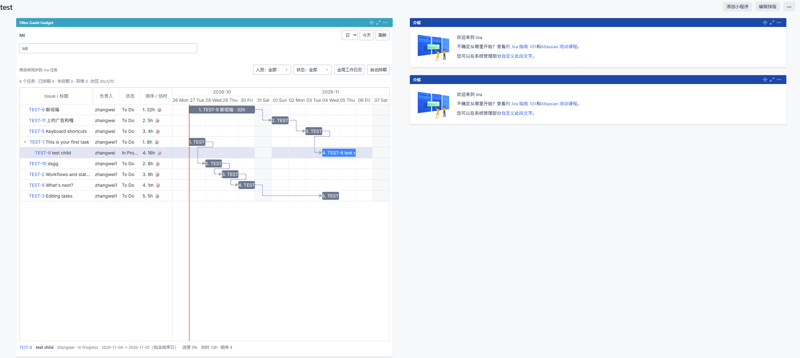

# Filter Gantt Gadget

适用于 **Jira Software Data Center 10.3.18** 的甘特图插件。将已保存的 Jira 筛选器中的任务展示在仪表盘中，支持自动排期、拖动调整、人员和状态筛选，并将排期修改同步到 Jira 原任务。

当前版本：**1.3.1**。

## 效果图



## 主要功能

- **筛选器驱动**：选择有权访问的 Jira 筛选器，支持输入名称搜索；可固定共享筛选器，也可让每位查看者独立选择。
- **甘特图展示**：日、周、月刻度，今天标记，父子任务层级、同人员任务顺序连线及可选的 Blocks 依赖线。
- **自动排期**：按负责人分组，同一人员按拖动顺序排期，结合预估工时、工作日和任务依赖计算日期。
- **直接调整**：拖动甘特条调整开始日期，拉伸条两端调整预估工时，后续任务顺移；双击编辑任务或新增 Jira 评论。
- **原位更新**：修改后后台同步 Jira，保留当前筛选、刻度、折叠和滚动位置。
- **人员与状态筛选**：支持搜索和多选，两种筛选取交集。
- **全局工作日历**：统一设置每周工作日、节假日和补班日期，供所有 Gadget 共用。

## 安装部署

详细步骤见 **[安装、升级与回滚文档](docs/INSTALL.md)**，包含源码构建、JAR 安装、Docker Compose 开启上传入口、日期字段配置和故障排查所需的部署说明。

快速安装：

1. 准备安装包 `filter-gantt-gadget-1.3.1.jar`；源码构建产物位于 `target/` 目录。
2. 使用 Jira 管理员账号进入 **管理应用 → 上传应用**，上传 JAR 并确认插件已启用。
3. 打开仪表盘，点击 **添加小程序 / Add Gadget**，搜索并添加 **Filter Gantt Gadget**。
4. 通过 Gadget 右上角菜单的 **编辑** 完成首次配置。

升级时上传相同插件的新版 JAR，完成后刷新一次仪表盘即可。若没有“上传应用”入口，请按安装文档配置。

## 使用说明

### 1. 首次配置

仪表盘所有者通过 Gadget 的 **编辑** 菜单设置：

- **模式**：推荐“每位查看者独立选择”。每个人可以保存自己的筛选器和时间刻度；“固定共享 Filter”则统一使用作者指定的筛选器。
- **默认筛选器**：在下拉框中输入名称匹配，再选择需要展示的筛选器。
- **开始、结束日期字段**：选择两个不同的可写日期字段，例如 **Target start / Target end**，或自定义开始日期与截止日期。
- **显示选项**：设置初始刻度、图表高度、任务数上限、父子层级、Blocks 依赖线和自动刷新间隔。

点击 **保存共享配置** 后加载任务。日期字段须适用于目标任务并加入项目的编辑界面；创建日期和更新日期不可用于排期写回。结束日期包含当天。

### 2. 查看与筛选任务

在筛选器控件中输入名称并选择，即可加载对应任务。每位用户只能查看自己在 Jira 中有权访问的数据。

- 使用 **日 / 周 / 月** 切换刻度，点击 **今天** 定位当前日期。
- 打开 **人员** 或 **状态** 下拉框，输入名称搜索并勾选需要显示的选项；支持全选和清空。
- 点击任务查看详情，点击 Issue Key 打开 Jira 原任务；通过左侧箭头展开或折叠子任务。
- 缺少日期或日期异常的任务会在对应清单中列出。
- 点击 **刷新** 重新读取完整筛选结果；也可在编辑配置中设置定时刷新。

默认读取上限为 500 个任务，可配置到 1000 个。结果被截断时，需要缩小筛选范围后再自动排期。

### 3. 自动排期

1. 点击工具栏最右侧的 **自动排期**。
2. 选择 **排期起点**，填写各任务的 **预估时间**，并选择负责人。人员下拉框本身支持输入姓名或账号搜索，可加载更多候选人员。
3. 列表自动按人员分组。在同一人员内拖动任务行，或使用上下箭头调整先后顺序；更换负责人后任务会重新归组。
4. 需要保留既有日期的任务可勾选 **锁定**，其日期和估时仍须符合排期规则。
5. 点击弹窗下方的 **自动排期** 计算并预览结果。
6. 检查日期，点击 **应用并同步到 Jira**，将修改写入原任务。

预估时间支持 `h`、`d`、`w`，例如 `4h`、`2d`、`1w 2d`，也支持 `m`。每天工时和每周天数的换算读取 Jira 工时设置。

排期按天计算容量：同一天可顺序安排多个小任务，当天剩余容量不足时，整个下一任务移到下一个工作日；大任务跨工作日安排。已完成任务跳过，非工作日排除，Blocks 前置依赖参与校验。未完成的前置任务不在筛选范围内时，需要扩大筛选范围。

### 4. 直接修改甘特条

- **拖动条中间**：调整任务开始日期，并顺移同一人员的后续任务及受影响的依赖任务。
- **拖动条两端**：按工作日长度调整预估工时，再计算后续任务日期。
- **双击甘特条**：修改预估时间、开始日期、负责人，或填写新增 Jira 评论，点击 **保存到 Jira**。

拖动和拉伸会直接同步 Jira，无需额外点击保存。双击编辑中的备注作为新的 Jira 评论保存，已有评论可在弹窗中查看。正常保存后图表原位更新，不重新加载整个 Gadget。

### 5. 设置全局工作日历

点击工具栏中的 **全局工作日历**，设置每周工作日、非工作日期和补班日期。多个日期可用逗号或换行分隔，格式为 `YYYY-MM-DD`。

- 仅 Jira 管理员可以修改，其他用户只读。
- 所有仪表盘、Gadget 和筛选器共用同一份日历。
- 默认周一至周五工作，例外日期为空。
- 保存日历影响后续排期计算，已有 Jira 任务日期不会自动改变；需要重新预览并应用排期。
- 从旧版本升级时，原 Gadget 内的日历设置不再生效，请在全局入口统一录入。

### 6. 权限与同步结果

仪表盘所有者可以在插件中修改任务，其他查看者只读。实际保存还需满足当前用户在 Jira 中的编辑、分配、日期和评论权限，以及字段和工作流约束。

任务估时写入 Jira 的 **原始预估时间**，开始和结束日期写入配置的日期字段，负责人和新增评论也同步到原任务。插件保存个人视图偏好、任务顺序和全局日历。

同步结果会显示已保存、失败和未执行的任务。多人修改或全局日历发生变化时，按提示刷新后重新排期。若保存响应丢失，插件会核实 Jira 实际数据，不自动重复提交；无法核实时会暂停编辑，需手动刷新后继续。

## 源码构建与开发

需要 JDK 17、Maven 3.9.9+、Node.js 22/24 LTS 与 npm。

```powershell
mvn -B -DskipTests=false clean package
```

构建包含前端依赖安装、单元测试、资源打包和 Java 测试，生成 `target/filter-gantt-gadget-1.3.1.jar`。浏览器回归需本机 Chrome，单独运行：

```powershell
npm --prefix frontend run test:browser
```

图表使用 **DHTMLX Community 10.0.3 / MIT**，资源及许可证随安装包提供，运行时无需访问公网加载图表库。

## GitHub 自动发布

普通分支推送和 Pull Request 执行构建与测试，安装包在 Actions 运行页面的 **Artifacts → filter-gantt-gadget** 中下载；测试报告单独保存在 **test-reports**。

发布版本时，先提交并推送包含此 Workflow 的代码，确认 `pom.xml` 中的项目版本，再创建并推送同名版本标签。例如项目版本为 `1.3.1` 且该标签尚未使用时：

```powershell
git tag -a v1.3.1 -m "Release 1.3.1"
git push origin v1.3.1
```

标签必须为 `v` 加项目版本，且不能是 SNAPSHOT。所有构建、测试和包校验通过后，Workflow 自动创建对应的 GitHub Release，并附加可安装的插件 JAR 和 `SHA256SUMS.txt`。带后缀的版本（例如 `1.3.2-rc.1`）标记为预发布。

已存在的 Release 会补充缺失附件，重跑时保留已有同名附件。普通分支手动运行只构建；在包含新 Workflow 的版本标签上手动运行或重跑，才会发布。此前完成的旧 Workflow 不会自动补发，已有旧标签也不要强制覆盖，应更新项目版本并发布新标签。

发布使用 GitHub 自带的 `GITHUB_TOKEN`，只在发布任务授予 `contents: write` 权限，无需额外配置个人 Token。创建与附加附件使用 [GitHub CLI Release 命令](https://cli.github.com/manual/gh_release_create)。

## 更多文档

- [安装、升级与回滚](docs/INSTALL.md)
- [更新日志](docs/RELEASE_NOTES.md)
- [原位同步更新说明](docs/IN-PLACE-SYNC-1.3.1.md)
- [REST 与权限说明](docs/API.md)
- [测试与验收](docs/TEST_PLAN.md)
- [兼容性说明](docs/COMPATIBILITY.md)
- [第三方许可证](THIRD-PARTY-NOTICES.md)
