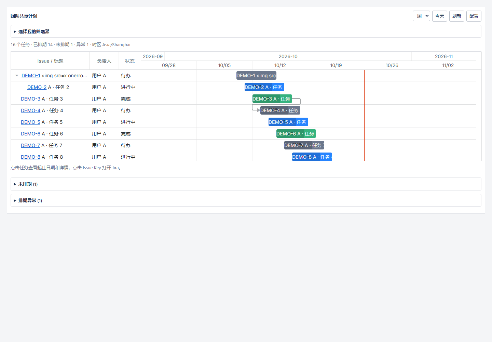

# Filter Gantt Gadget — 交付记录

> 当前请使用 **1.0.3**. 保存配置生效和搜索下拉框的修复见 [最新修复记录](FIX-1.0.3.md). 下文保留首版历史交付证据.

版本 **1.0.0**；交付日期 **2026-10-26**。

已完成首版源码、P2/OSGi JAR 和本地自动化验证。**尚未通过真实 10.3.18 安装验证**：当前没有连接目标 Jira 测试实例，因此 UPM、Gadget 目录、实际 AO 数据库、企业 XSRF 策略和跨节点运行尚待验收。

## 安装包

- 文件：`target/filter-gantt-gadget-1.0.0.jar`。
- 大小：902,085 bytes。
- SHA-256：`287557BF0816E75A618C4C2760278EF777262BB4CDE29FDA7FE24263E55F9177`。
- plugin key：`com.qixia.jira.filter-gantt-gadget`。
- 已检查 16 个必需包条目、8 个 Java 17 class、OSGi 标识/导入、Dashboard/REST v2/AO 模块、Soy、AMD、压缩 CSS/JS 和完整 MIT 许可证；没有嵌入 Jira 内核或其他 Java JAR。
- 校验命令：`./scripts/verify-package.ps1`。机器可读结果见 [package.json](validation/package.json)。

## 构建与版本

实际使用 OpenJDK **17.0.2**（class major 61）、Maven **3.9.9**、AMPS **9.5.2**、Node **24.20.0**、npm **10.9.1**、Rollup **4.52.5**、Playwright **1.56.1**、Chrome **155.0.8059.85**、DHTMLX Community **10.0.3 / MIT**。目标 Jira API 精确锁定 **10.3.18**，宿主 Platform BOM **7.2.40**。

标准构建：

```powershell
mvn -B -DskipTests=false clean package
```

本机首次解析依赖时，Java HTTP 连接多次超时；先用 curl 从官方 Central/Atlassian 仓库补齐 Maven 缓存，随后实际完成：

```powershell
# 已设置 JAVA_HOME 和 PATH 为 Java 17 / Node；使用本机项目内缓存
.tools/apache-maven-3.9.9/bin/mvn.cmd -o -B -ntp -Dmaven.repo.local=.tools/m2 -DskipTests=false clean package
```

结果 **BUILD SUCCESS**，耗时 **1 分 53 秒**，完成时间 **2026-10-26 20:21:45（Asia/Shanghai）**。本次包含 npm ci、前端测试/构建、资源压缩、Java 编译、JUnit、Spring Scanner、禁用依赖检查、OSGi 清单生成/校验、JAR 与 OBR。构建传输辅助工具不进入插件，运行时不需要它。

完整记录：[构建日志](validation/build.txt)。AMPS 的 REST 文档生成在 Java 13+ 自动跳过，接口合同已提供在 `docs/API.md`；第三方源码中的一条 JSDoc `@topic` 压缩警告不影响构建。

## 自动化结果

- 前端单元测试 **15/15**：日期/用户时区、DST、同日起止、未排期/异常、权限失败、串行分页、上限、取消、配置及转义。[记录](validation/frontend-unit.txt)
- 后端 JUnit **33/33**：Dashboard ACL、模块检查、会话身份、Filter 许可、XSRF、未知字段拒绝、固定模式、AO 服务与集群锁合同。[分组结果](validation/backend-tests.json)
- 浏览器 mock 集成 **12/12**：针对发布目录中的**压缩 JS/CSS**，覆盖多实例、A/B 独立及跨浏览器个人视图、权限撤销、只读、XSS、共享保存、两个 Context Path、快速切换、1000 条截断、网络错误恢复和字段删除。[记录](validation/browser.txt)
- 最终干净构建产生的压缩资源 SHA-256 与上述浏览器测试的资源一致。
- Mock 性能样例：本机 Chrome 同时 5 个 Gadget × 500 条任务，约 **2.01 秒**完成渲染；这是本地模拟服务结果，不能作为真实 Jira 性能承诺。
- `git diff --check` 通过。

合计 **60 项**自动化检查通过。后端服务使用官方 API + mock；浏览器使用本地模拟 Jira REST。没有将这些结果计为真实 Jira 安装、数据库或集群验证。

## 已实现的 P0

- 真正的 Dashboard Item、共享配置表单与校验、命名 AMD/Soy/web-resource。
- 收藏/本人/共享 Filter 搜索；当前用户同源 Session 查询 Issue，分页和明确截断，无管理员代理。
- 只读日/周/月图表、今天标记、详情、状态色、同源 Issue 链接、未排期与异常清单。
- 多实例隔离、请求中止和销毁；错误/后台时清除旧图表，重新进入时重新验证权限。
- SHARED_FIXED / VIEWER_SELECTABLE；个人 Filter/刻度存 AO，与共享 Preferences 分开；用户与 Gadget 唯一身份、集群锁保护写入。
- 登录/许可注解、Dashboard/模块/Filter 检查、XSRF 与 XSS 防护；个人接口不接受 userKey。
- 本地资源、锁文件、开源许可证、CI、安装/接口/测试/回滚文档。

另包含可选父子层级、Blocks 依赖和后台暂停刷新。P1 全屏/PNG 导出未实现；P2 Issue 拖拽写回不在本次交付范围。

## 验收与部署

真实安装和跨用户、跨节点验证仍是上线前的剩余工作。按 [安装说明](INSTALL.md) 在测试 Jira 10.3.18 上传该 JAR，再执行 [TEST_PLAN.md](TEST_PLAN.md) 中 TC-01–TC-22 对应检查，尤其是 getGadgetId/Portlet 的关系、原生权限、REST v2/XSRF、AO 目标数据库约束和 CSP。

回滚：通过 UPM 禁用插件，或恢复旧 JAR；保留 AO 数据，不自动删表。首次安装失败时卸载应用并保留脱敏日志排查，不直接改 Jira 安装目录。

实现依据与实际 API 核验见 [COMPATIBILITY.md](COMPATIBILITY.md)，版本变化见 [RELEASE_NOTES.md](RELEASE_NOTES.md)。


